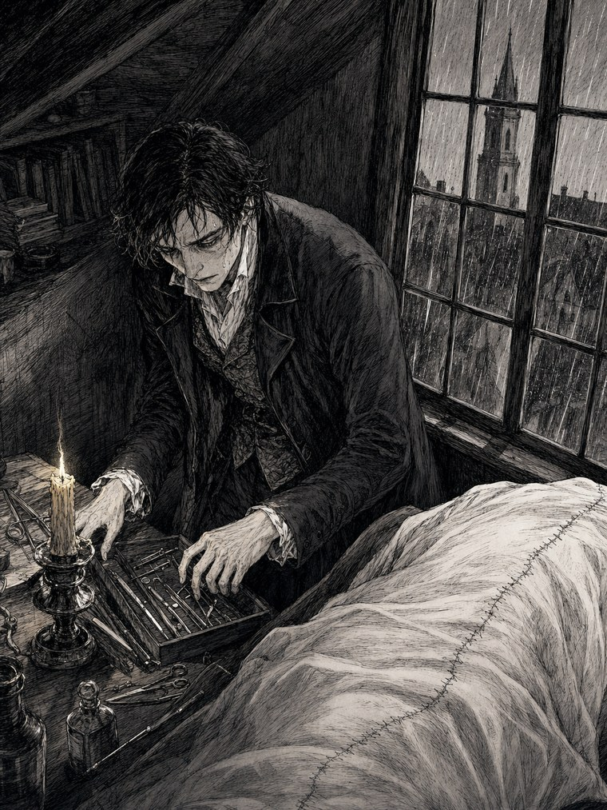
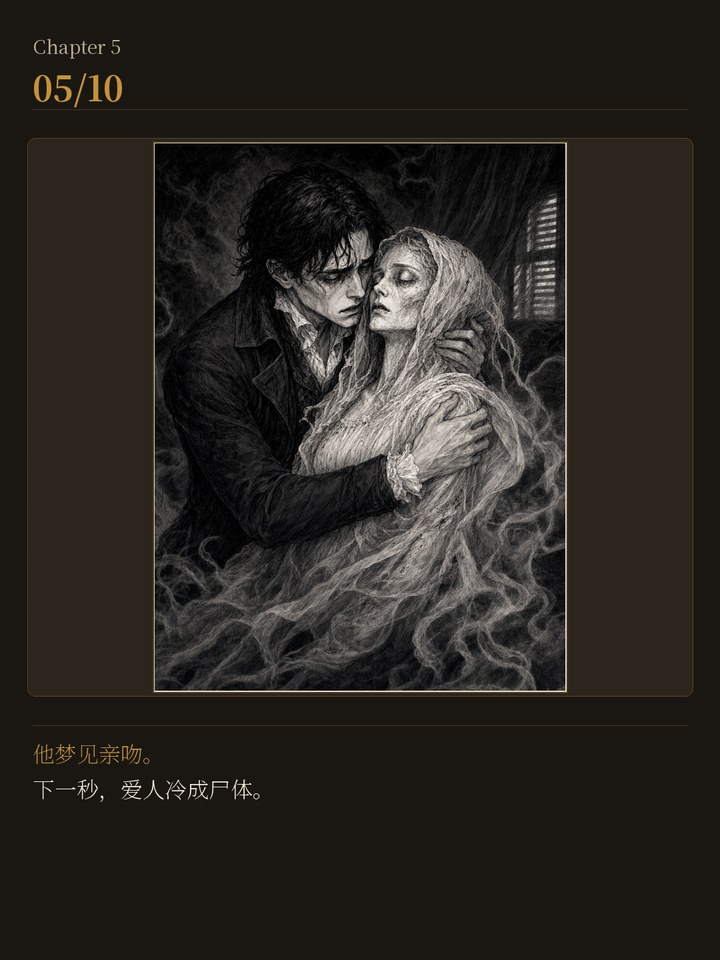
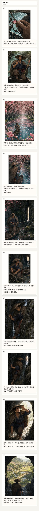
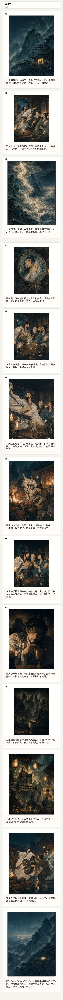
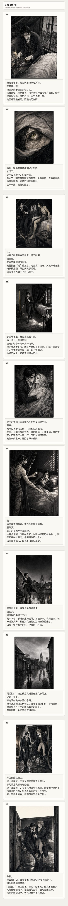
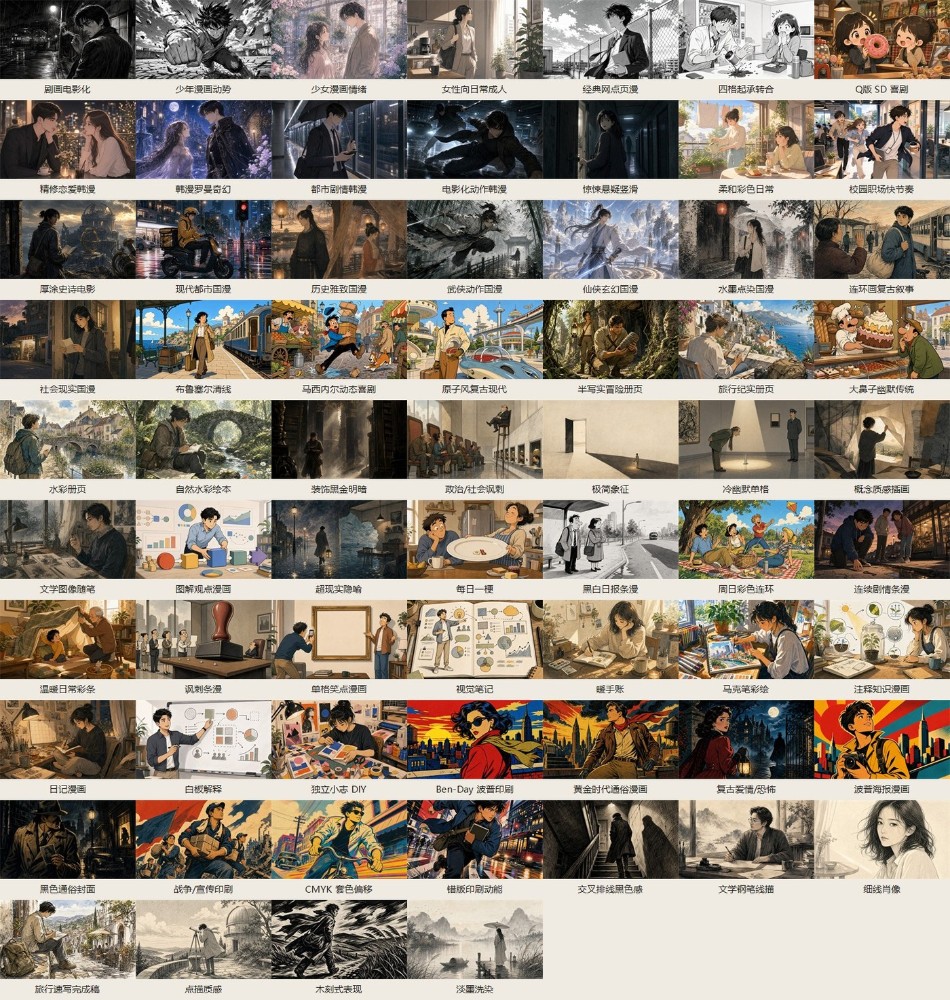

<div align="center">

<h1>📖 → 🎨 book-to-comic</h1>

<p><b>Hand it a book. Get back a whole chapter of comics.</b><br>
一句话，把一本书变成一整章连续漫画。</p>

<p>


</p>

<p>An Agent Skill (for <b>Codex</b> / <b>Claude Code</b>) that reads a whole book — or a single poem — and adapts it into a serialized comic: research, storyboard, character design, panel art, Chinese lettering, and a ready-to-share delivery pack. <b>No model API key required.</b></p>

</div>

---

## ✨ Same skill, one line each — the art style follows the book

The hardest part isn't drawing pictures — it's *adapting*: what to draw, where to cut, how the camera moves. `book-to-comic` reads each book's temperament and picks a matching look on its own. Three books, three completely different hands:

<table>
<tr>
<td width="33%" align="center">
<br>
<b>桃花源记</b><br><sub>The Peach Blossom Spring · classical prose</sub><br>
🎨 <i>Full-color Chinese manhua</i>
</td>
<td width="33%" align="center">
<br>
<b>将进酒</b><br><sub>Invitation to Wine · Li Bai's poem</sub><br>
🎨 <i>Ink &amp; cinematic light</i>
</td>
<td width="33%" align="center">
<br>
<b>Frankenstein</b><br><sub>Mary Shelley · gothic novel</sub><br>
🎨 <i>Gothic pen-and-ink</i>
</td>
</tr>
</table>

> Same one-sentence command each time (`把《XX》画成漫画`). Nobody told it to switch styles — it read the book and decided.

---

## What it does

You say one sentence — *"turn 《XX》 into a comic"* — and it handles the rest:

**read the original → design a consistent cast → break it into panels → write the captions → typeset Chinese lettering pixel-by-pixel → lay out and export.**

What you get back isn't a handful of illustrations — it's a **whole connected chapter**: a scroll you can read top to bottom, plus PDF / EPUB / CBZ. The same character keeps the same face across the chapter, and the captions are typeset by program, never smudged AI gibberish.

---

## 🖼 Showcase

### One sentence → a whole chapter

Not a single picture — a continuous 10–13 panel chapter, story beat by story beat.

<table>
<tr>
<td align="center" width="25%"><br><sub>桃花源记 · 全彩国漫</sub></td>
<td align="center" width="25%"><br><sub>将进酒 · 泼墨电影光</sub></td>
<td align="center" width="25%"><br><sub>Frankenstein · 哥特墨线</sub></td>
</tr>
</table>

### The complete chapter — one continuous scroll

Not single images stitched together. Each of these is the **entire chapter**, top to bottom, as one long image.

<table>
<tr>
<td align="center" width="33%"><br><sub>桃花源记 · 10 panels</sub></td>
<td align="center" width="33%"><br><sub>将进酒 · 13 panels</sub></td>
<td align="center" width="33%"><br><sub>Frankenstein · 10 panels</sub></td>
</tr>
</table>

### 60+ built-in art styles — it doesn't draw like one hand

<div align="center">
<br>
<sub>Manga · Webtoon · Chinese manhua · ink-wash · Franco-Belgian ligne claire · retro halftone · pen-and-ink … it reads the book's temperament and picks; or name a style in one line.</sub>
</div>

---

## 🔧 Four things it actually gets right

| | |
|---|---|
| **Characters don't drift** | Same person, same face across a whole chapter. It locks a character "fingerprint" and checks every new panel against the earlier ones. |
| **A whole chapter in one pass** | Not stitched one image at a time — one generation for a whole chapter, panel count set by the content. |
| **Text doesn't smudge** | Captions are typeset onto the art by program, character by character — not the melted fake text image models produce. |
| **Style follows the book** | It reads the book's temperament and picks the look automatically; drawn wrong or off-style, the gates send it back. |

The real work isn't image generation — it's **reading the book first, then deciding how to adapt it.** A pipeline of **eighteen deterministic quality gates** (panel structure, character consistency, full-bleed art, caption overflow, repetition, appeal…) sits in front of every delivery. It doesn't ship a chapter that fails them.

---

## 🚀 Quick start

```bash
# Python 3.10+
pip install -e .          # installs deps + registers the `book-to-comic` command
```

Drop this folder into your agent's skills directory, restart the session, then just say:

```text
把《活着》第一章做成一套漫画
# or:  turn chapter 1 of <book> into a comic
```

Skills directory:

| Host | Path |
|---|---|
| Codex (user) | `~/.agents/skills/book-to-comic/` |
| Claude Code (user) | `~/.claude/skills/book-to-comic/` |

You can upload `.txt` / `.md` / `.docx` / text-layer `.pdf`, or just give a title and let it research online.

---

## 🎛 Two ways to run — neither needs an API key

- **Host has an image tool** (some Codex surfaces): one line, fully automatic, the whole pack comes back — you never touch an image.
- **Host has no image tool** (Claude Code / others): it does all the adaptation, storyboard, captions and per-panel prompts, then hands you a pick-list. You generate the images in *any* tool (free tiers are plenty), drop them back in a folder, and it finishes the compose.

The hard part — adaptation and paneling — is always handled for you. You only swap tools at the image-generation step.

---

## 📦 What you get

A `final/` folder: a long scroll (`comic-long.png`), carousel cards, three cover options, and `comic.pdf` / `comic.cbz` / `comic.epub`, plus one packaged share bundle — ready to post, keep, or print.

> Comics here are a derivative adaptation of the source; they don't replace the original book.

---

<details>
<summary><b>🛠 Full command reference & pipeline internals</b> (click to expand)</summary>

The host model does the reading and creative judgement; the Python scripts only do deterministic work: text extraction, schema validation, asset materialization, Pillow typesetting, PDF/CBZ/EPUB/ZIP export.

Formal pipeline order (planning / text / visual-contract gates first, then image assets — call them out of order and the commands stop you):

```bash
python -m book_to_comic init-project --book <title> --project-dir outputs/proj
# — host plans grounding profile / bibles / episode —
python -m book_to_comic validate-grounding --project outputs/proj
python -m book_to_comic source-chunk --project outputs/proj --chapter-id CH1
python -m book_to_comic build-story-ir --project outputs/proj
python -m book_to_comic validate-source-coverage --project outputs/proj
python -m book_to_comic build-visual-contract --project outputs/proj
python -m book_to_comic validate-visual-contract --project outputs/proj
python -m book_to_comic export-project-prompts --project outputs/proj
# — visual contract must pass before any panel is materialized —
python -m book_to_comic materialize-image --project outputs/proj --kind panel --asset-id panel-01 --version 1 --snapshot <snap.json> --prompt outputs/proj/prompts/panel-01.txt --panel-index 1
python -m book_to_comic approve-asset --project outputs/proj --asset-id panel-01 --qa-summary pass
python -m book_to_comic validate-project-assets --project outputs/proj
# — independent second review; verdicts only land via the record command —
python -m book_to_comic record-story-review --project outputs/proj --author-pass-id a --reviewer-pass-id b --reviewer-kind independent-subagent --evidence-file review.json
python -m book_to_comic validate-story --project outputs/proj
python -m book_to_comic record-appeal-review --project outputs/proj --reviewer-pass-id b --reviewer-kind independent-subagent --checks-file appeal.json
python -m book_to_comic set-card-theme --project outputs/proj --theme gallery
python -m book_to_comic compose-project --project outputs/proj
```

Serialized series (one project dir per episode + a `series.json` ledger):

```bash
python -m book_to_comic init-series --dir outputs/series --book <title> --episodes "EP01:...,EP02:..."
python -m book_to_comic ingest-source --series outputs/series book.txt   # import the uploaded text
python -m book_to_comic add-episode --series outputs/series --episode EP01   # hands the source to EP01
python -m book_to_comic add-episode --series outputs/series --episode EP02   # inherits the previous episode's bibles
python -m book_to_comic series-status --series outputs/series
```

Inbox path when the host has no image tool (the sanctioned fallback, same approval gates):

```bash
python -m book_to_comic inbox-prepare --project outputs/proj
# generate images in any tool per the pick-list, name them panel-NN.png, drop into tmp/inbox/
python -m book_to_comic inbox-import --project outputs/proj
python -m book_to_comic approve-asset --project outputs/proj --asset-id panel-01 --qa-summary "looks good"
```

### Output layout

```text
outputs/<project>/          # one project = one episode
├── project.json  manifest.json  state.json
├── source/                 # extracted text (never in a public bundle)
├── planning/               # grounding_profile / bibles / visual_contract
├── story/                  # episode-001.json + balloon_plan.json
├── prompts/  text-prompts/ # compiled per-panel image & lettering prompts
├── assets/                 # candidates / references / panels(NN.png)
├── review/                 # reference-pack / consistency sheets
├── final/                  # comic-pages, cover, cards, long-png, pdf/cbz/epub, production.zip
└── qa/                     # gate reports + delivery-gate.json
```

The delivery bundle comes in three rights-tiers (compose emits exactly one): `production.zip` (public-shareable), `production-private.zip` (self-use only), `production-debug.zip` (full workspace, never public).

### Built-in styles

`editorial`, `ink-sketch`, `franco-belgian-bd`, `manga`, `webtoon-manhwa`, `manhua`, `comic-strip`, `doodle`, `retro-halftone` — each with researched sub-styles. Literary / non-fiction leans `editorial / ink-sketch`; mobile serialized drama leans `webtoon-manhwa / manhua / manga`.

### Tests

```bash
python -m unittest discover tests
```

111 regression tests, including fault-injection cases from three release-audit rounds (rights gate fail-closed, delivery-stamp output binding, review-record provenance, append-only asset state machine, strict bundle allowlist, packager self-checks, and more).

</details>

---

<div align="center">
<sub>MIT License · Chinese lettering uses the CJK fonts your OS already ships — no font binaries bundled.</sub>
</div>
